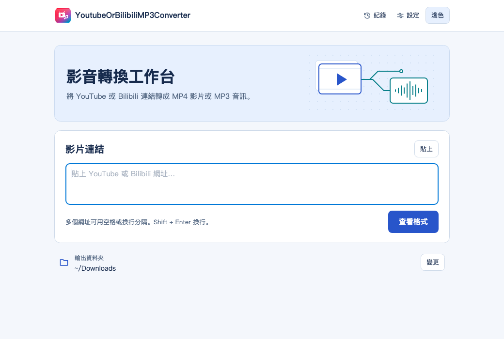

# YoutubeOrBilibiliMP3Converter v1.5.13

Avalonia 桌面應用：將 **YouTube** 或 **Bilibili** 影片網址轉換成 **MP4 / MP3**（本機使用 `yt-dlp` + `ffmpeg`）。

工作台預設採用淺色主題。右上角可切換深色或跟隨系統，程式會記住選擇。



## 功能

- 可連續貼上多個 YouTube / Bilibili 連結，以空格或換行分隔，或用「貼上」分次追加。按「查看格式」後選一次 MP4 或 MP3，即依輸入順序處理。
- 在「設定」以關鍵字搜尋 YouTube 與 Bilibili，點選結果即可查看可用格式。點選最近使用的關鍵字可再次搜尋。
- 解析網址：顯示標題、時長、觀看次數、上傳日期
- 輸出格式：MP4（480P / 720P / 1080P / 4K）或 MP3
- 轉換時顯示下載進度與速度，完成後可直接開啟檔案。
- **字幕搭配**（預設關閉）：可選下載中文優先字幕為外掛 `.srt`；MP4 並內嵌字幕軌；MP3 另產生 `.lrc` 歌詞檔
- 「紀錄」可開啟本次執行中已完成的檔案，或重新使用解析過的連結。

## 執行

```bash
dotnet run
```

## 下載（GitHub Releases）

| 檔案 | 平台 | 說明 |
|------|------|------|
| `…-win-x64.exe` | Windows x64 | 單一執行檔，下載後直接執行 |
| `…-osx-arm64.dmg` | macOS Apple Silicon | 開啟後把 App 拖進「應用程式」 |
| `…-osx-x64.dmg` | macOS Intel | 同上 |
| `…-linux-x64` | Linux x64 | 單一執行檔（`chmod +x` 後執行） |
| `…-osx-arm64.zip` / `…-osx-x64.zip` | macOS | `.app` 壓縮檔，解壓後拖進「應用程式」 |
| `…-win-x64.zip` / `….tar.gz` | Windows / 各平台 | 資料夾版，內容與上面相同 |

macOS 版未經 Apple 公證，第一次開啟若被擋，請在 App 上按右鍵 →「打開」。

建置全部發佈檔：`./build-release.sh`（輸出到 `dist/`）。

## 安裝配套工具（yt-dlp + ffmpeg）

程式啟動時若偵測到缺少工具，首頁會顯示「還差轉檔工具」提示：

- **一鍵安裝**：macOS 會開啟「終端機」自動安裝（沒有 Homebrew 時會先安裝 Homebrew）；Windows 會以系統管理員身分開啟 PowerShell 執行 winget。
- **複製指令**：想自己操作時，複製後貼到終端機執行。
- **重新檢查**：安裝完成後回到程式即會自動偵測，不需重啟。

macOS 手動安裝：

```bash
brew install yt-dlp ffmpeg
```

## Windows 使用前安裝

第一次使用前，請先安裝轉檔需要的兩個小工具。只要照下面做一次就好。

1. 按鍵盤的 `Windows` 鍵。
2. 輸入 `終端機` 或 `Terminal`。
3. 在「終端機」上按右鍵，選擇「以系統管理員身分執行」。
4. 複製下面這行指令，貼到終端機裡，然後按 Enter：

```powershell
winget install yt-dlp.yt-dlp Gyan.FFmpeg
```

5. 如果畫面問你是否同意，輸入 `Y`，再按 Enter。
6. 等安裝完成後，關掉終端機。
7. 重新開啟「YoutubeOrBilibiliMP3Converter」，就可以開始使用。

如果 Windows 顯示找不到 `winget`，請先從 Microsoft Store 更新或安裝「應用程式安裝程式」。

## 建置 Windows EXE

```powershell
powershell -ExecutionPolicy Bypass -File .\build-windows.ps1
```

預設輸出：`publish\win-x64\YoutubeOrBilibiliMP3Converter.exe`。

Windows ARM：

```powershell
powershell -ExecutionPolicy Bypass -File .\build-windows.ps1 -Runtime win-arm64
```

## 發佈 Windows / macOS / Linux

```bash
./build-release.sh
```

輸出在 `dist/`：

| 檔案 | 平台 |
|------|------|
| `YoutubeOrBilibiliMP3Converter-v*-win-x64.zip` | Windows x64 |
| `YoutubeOrBilibiliMP3Converter-v*-osx-arm64.tar.gz` | macOS Apple Silicon |
| `YoutubeOrBilibiliMP3Converter-v*-osx-x64.tar.gz` | macOS Intel |
| `YoutubeOrBilibiliMP3Converter-v*-linux-x64.tar.gz` | Linux x64 |

## macOS 設定

```bash
brew install yt-dlp ffmpeg
```

YouTube 若出現 `HTTP Error 403: Forbidden`，多半是 `yt-dlp` 過舊。請先更新：

```bash
brew upgrade yt-dlp
```

會員或需登入的影片，請匯出 `cookies.txt` 後在「設定」的 Cookies 欄位匯入。

## 使用方式

1. 在「影片連結」貼上網址。多個網址可以空格或換行分隔。
2. 確認首頁下方的輸出資料夾，需要時按「變更」選擇位置。
3. 按「查看格式」或 Enter 解析連結。
4. 點選所需的 MP4 畫質或 MP3 即開始轉換。也可用方向鍵選擇格式，再按 Enter 確認。

### 搜尋說明

- **YouTube**：透過本機 `yt-dlp`（`ytsearchN:關鍵字`）
- **Bilibili**：優先使用 B 站官方搜尋 API；失敗時再嘗試 `yt-dlp bilisearch`
- 結果會過濾：僅保留**標題或介紹**含完整關鍵字的影片（避免只沾邊、不相關的推薦）

## 注意事項

播放清單、合集與頻道列表的實測結果及待實作範圍，見[解析可行性評估（2026-10-31）](docs/playlist-channel-feasibility-2026-10-31.md)。此文件為評估紀錄，尚未新增逐片勾選介面。

YouTube 影片 / 播放清單、Bilibili 影片會由 `yt-dlp` 處理。Bilibili 會自動使用瀏覽器 headers，並在可用時讀取 Firefox / Chrome / Edge cookies。部分私人、地區限制、會員或需登入的影片仍可能失敗。

範例 Bilibili 網址：

```text
https://www.bilibili.com/video/BV158dfBAEbH/
https://www.bilibili.com/video/BV15hdfBaECr/
https://www.bilibili.com/video/BV1q4dfBNE8X/
```

## App 圖示

圖示以向量繪製，原始碼在 `tools/IconGen`。修改後重新產生 `Assets/AppIcon.icns`、`Assets/app-icon.png`、`Assets/app.ico`：

```bash
cd tools/IconGen && dotnet run -- out full && iconutil -c icns out/AppIcon.iconset -o ../../Assets/AppIcon.icns && cp out/app-icon.png out/app.ico ../../Assets/
```

舊版貓咪圖示可從 v1.3.0 取回（`git show v1.3.0:Assets/app-icon.png`）。
